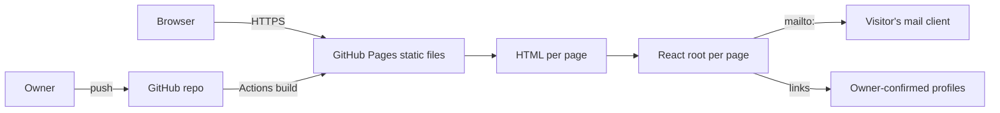

# BUILD — Architecture, Tooling, Deployment

| Field | Value |
|---|---|
| Document status | Draft v0.3 — built and verified locally; not deployed |
| Last updated | 2026-11-06 |
| Related | [PRD.md](PRD.md), [DESIGN.md](DESIGN.md), [TODO.md](TODO.md) |

---

## 1. Architecture

A **static, multi-page site**. Each page is a real HTML file with its own `<head>` and its own React root. GitHub Pages serves those files directly. There is no client-side router, no backend and no database.



Why this shape:

- Direct URL and refresh work with no fallback hack (FR-009).
- Each page carries real metadata and real JSON-LD (FR-012, NFR-004).
- No router dependency, so one less package to approve, audit and keep current.
- The first screen is **prerendered at build time**: each HTML file ships the real markup and only hydrates, so first paint does not wait on the JS bundle. This is the largest available LCP lever for a React site (NFR-003).

Cost accepted: full page load between pages; no client-side transitions.

## 2. Stack

| Layer | Choice | Status |
|---|---|---|
| UI library | React.js | Accepted |
| Build tool | Vite | Accepted |
| Language | JavaScript (no TypeScript) | Accepted |
| Styling | Plain CSS with custom properties | Accepted |
| Router | None | Accepted |
| UI components | Free ReactBits, used sparingly | Accepted with limits (ADR-006) |
| Hosting | GitHub Pages, free github.io domain | Accepted |
| CI/CD | GitHub Actions | Proposed — one-line approval needed (ADR-004) |
| Content | JS modules in `src/content/` | Accepted |
| Rendering | Build-time prerender of every page, then hydrate | Accepted |
| Typeface | Space Grotesk variable, latin subset, self-hosted | Accepted |
| Package manager | npm | Accepted (ADR-010) |
| Lint / format | ESLint + Prettier | Deferred — not installed yet |
| Node | `22` in `.nvmrc`, `>=22` in `engines` | Accepted (ADR-010) |

## 3. Repository structure

```text
/ (repository root)
├─ index.html            Home
├─ about.html
├─ experience.html
├─ contact.html
├─ blog.html
├─ 404.html
├─ AGENT/                these planning documents
├─ public/               files served as-is: résumé, favicon, og image, robots.txt, sitemap.xml
├─ src/
│  ├─ layout/            Layout: header, nav, footer, skip link
│  ├─ entries/           one hydrate-or-mount file per HTML page
│  ├─ pages/             one component per page
│  ├─ components/        small shared presentational components
│  ├─ content/           owner-supplied content as JS modules
│  ├─ assets/fonts/      Space Grotesk woff2 + OFL licence
│  ├─ styles/            tokens.css, base.css
│  └─ prerender.js       build-time render map used to inject markup
├─ scripts/              check-placeholders.mjs, size-report.mjs, prerender.mjs
├─ .github/workflows/    ci.yml (deploy.yml once ADR-004 is approved)
└─ vite.config.js
```

Planning documents stay in `AGENT/`; a move to `docs/` was considered and is not worth breaking every existing link.

## 4. Page entries

| HTML file | Page | Component |
|---|---|---|
| `index.html` | Home | `src/pages/Home.jsx` |
| `about.html` | About | `src/pages/About.jsx` |
| `experience.html` | Experience / Education / Achievements | `src/pages/Experience.jsx` |
| `contact.html` | Contact | `src/pages/Contact.jsx` |
| `blog.html` | Blog index | `src/pages/Blog.jsx` |
| `404.html` | Not found | `src/pages/NotFound.jsx` |

`projects.html` is added only if OQ-001 approves it.

Each entry file contains the full document head (`title`, `description`, `canonical`, Open Graph, JSON-LD where applicable) and one module script that mounts the React root:

```html
<script type="module" src="/src/entries/about.jsx"></script>
```

## 5. Vite configuration

```js
// vite.config.js
import { defineConfig } from 'vite'
import react from '@vitejs/plugin-react'

export default defineConfig({
  base: process.env.VITE_BASE || '/',
  build: {
    rollupOptions: {
      input: {
        main: 'index.html',
        about: 'about.html',
        experience: 'experience.html',
        contact: 'contact.html',
        blog: 'blog.html',
        notFound: '404.html',
      },
    },
  },
})
```

Rules:

- `base` comes from the repository form, not from a hard-coded string: `<username>.github.io` uses `/`, any other repository uses `/<repo>/`.
- Asset references in code use `import.meta.env.BASE_URL`, never a leading-slash literal. This is the only correct mechanism; there is no other Vite API for it.
- `build.sourcemap` stays `false` (default).
- `rollupOptions.input` is correct for the installed Vite 8.3.6; a rename to `rolldownOptions` was not needed, but re-check on a major upgrade.
- Verify with `npm run build && vite preview` before any deploy. `vite preview` is a smoke test, not a production server.
- `vite preview` falls back to `index.html` for unknown paths, so the 404 page can only be verified on GitHub Pages or with a plain static server.

### Build pipeline

```text
vite build                                    → dist/ (client bundle + 6 HTML shells)
vite build --ssr src/prerender.js --outDir .prerender
node scripts/prerender.mjs                    → injects rendered markup into each dist/*.html
```

`src/prerender.js` maps each HTML file to its page component and renders it with `react-dom/server`. `scripts/prerender.mjs` replaces `<div id="root"></div>` with the rendered markup. Entries then call `hydrateRoot` when the container already has children, and `createRoot` when it does not. `.prerender/` is build output and is ignored by Git.

Failure mode to watch: a page that touches `window` or `document` at module scope breaks the SSR build step. Keep browser access inside effects or event handlers.

## 5a. Dependencies

| Package | Why | Cost | Alternative |
|---|---|---|---|
| `react`, `react-dom` | UI runtime | 69 KB gzip in the shared chunk | Preact (~12 KB) — rejected: unnecessary divergence from the confirmed stack |
| `vite` | Build, dev server, SSR build | dev only | — |
| `@vitejs/plugin-react` | JSX transform, Fast Refresh | dev only | `-swc` variant; not needed |
| Space Grotesk woff2 (vendored) | Typeface | 22 KB, one request | system stack — rejected: no distinctive type |
| `playwright` | Headless Chromium for the local audit (`npm run audit`) | dev only, not shipped | manual checking — rejected: not repeatable |
| `axe-core` | Accessibility rules injected into the audit page | dev only, ~500 KB on disk, not shipped | manual review — rejected: misses rules |
| GitHub Actions | Build and deploy | free tier | branch publishing, not suitable for a Vite build |

## 6. Content layer

- All owner-supplied content lives in `src/content/*.js` as plain exported data. Components receive it as props.
- Unknown values are the literal string `[USER INPUT REQUIRED]` so the release gate can find them.
- Home, About, Experience, Contact and Footer read from the content layer. No personal fact is typed into JSX.
- Blog, if ADR-008 chooses Markdown, gets a build step; if it chooses JS modules, it uses the same content layer with no new dependency.

## 7. Assets

- Fixed-address files (résumé, favicon, og image, `robots.txt`, `sitemap.xml`) go in `public/`.
- Images used by components go in `src/assets/` so the build fingerprints them.
- Every meaningful image needs alt text; decorative images get `alt=""`.
- Only images the owner has rights to use (OQ-010).
- Hero images: explicit `width`/`height` or `aspect-ratio`, `fetchpriority="high"`, AVIF or WebP with a fallback, never `loading="lazy"`.
- Below-the-fold images: `loading="lazy"` plus `decoding="async"`.

## 8. Styling

- `src/styles/tokens.css` holds the palette, spacing and type scale as custom properties. Nothing outside tokens may declare a raw colour value.
- `src/styles/base.css` holds reset, typography defaults, focus styles and layout primitives.
- Per-page CSS is imported by the page component.
- No CSS framework, no CSS-in-JS, no utility library.

Token values and contrast evidence are in [DESIGN.md](DESIGN.md) §2.

## 9. Performance budgets

| Budget | Limit |
|---|---|
| Entry JS per page, gzip | ≤ 100 KB |
| Total CSS, gzip | ≤ 30 KB |
| Hero image | ≤ 200 KB |
| Any single image | ≤ 300 KB |
| Total page weight, Home | ≤ 900 KB |
| Third-party requests | 0 |

Enforced by `scripts/size-report.mjs` in CI (T1-05). Budgets are a proposal and can be raised by the owner with a written reason.

## 10. Accessibility implementation rules

Requirement: NFR-002.

- One `<h1>` per page; heading levels never skip.
- Landmarks: `header`, `nav`, `main`, `footer`; a skip link to `main` as the first focusable element.
- Focus style comes from tokens and must hit 3:1 against the surface behind it (DESIGN.md §2 lists the safe pairs).
- Target size ≥ 24×24 CSS px; ≥ 44×44 for primary actions on touch.
- No hover-only content.
- Images carry meaningful alt text or `alt=""`.
- Every animation has a `prefers-reduced-motion` path.
- Mobile navigation is a real `<button>` with `aria-expanded` and focus management, not a div.

## 11. SEO

Requirement: NFR-004, FR-012.

- Per-page `<title>` 50–60 characters and `<meta name="description">` 120–160 characters, written by hand in each entry file.
- Self-referencing `<link rel="canonical">` per page.
- Open Graph and Twitter card tags per page; one shared social preview image from OQ-008.
- JSON-LD `Person` on Home: name, job title, `sameAs` profile links, `url`. Only owner-confirmed values.
- `public/robots.txt` allows all; `public/sitemap.xml` lists the real page URLs. Regenerate the sitemap when a page is added.
- One `h1` per page reflecting the page's actual content.

## 12. Security

- No secrets anywhere; the build needs none.
- The repository is public, so nothing private is committed.
- External links use `rel="noopener noreferrer"` with `target="_blank"`.
- Only owner-approved personal data is published.
- Dependency count stays small and every dependency has a record (NFR-014).

## 13. Deployment

GitHub Pages, static artifacts, free github.io domain, no custom domain.

| Item | Value |
|---|---|
| Publishing source | GitHub Actions |
| Environment | `github-pages` |
| Node | pinned LTS, cached |
| Install | `npm ci` from the lockfile |
| Build | `npm run build` (client build + SSR prerender + markup injection) |
| Artifact | `dist/` |
| Secrets | none |
| Concurrency | one deployment at a time, do not cancel in progress |

Workflow shape: checkout → setup-node with cache → `npm ci` → `npm run build` → `npm run check:sizes` → configure-pages → upload-pages-artifact → deploy-pages. Lint is not part of the deploy until ESLint is installed (TODO T1-06). The placeholder check is a release gate run by the owner, not by CI, because placeholders are expected until OQ-006 is answered. Pin action majors and re-check current versions when writing the file; do not copy versions from this document.

**ADR-004 is still unapproved.** Deployment work is blocked until the owner confirms GitHub Actions in one line. The alternative is branch publishing, which is not designed for a Vite build.

### Rollback

Revert the offending commit on the default branch; the workflow redeploys the previous state. Tag each release so a known-good commit is easy to find. No other rollback machinery is needed for a static site.

### Post-deploy checklist

1. Workflow succeeded, no missing-file errors in the console.
2. Every page loads from navigation and from a direct URL, and survives refresh.
3. Unknown address serves the 404 page.
4. Images, fonts and the résumé load (no wrong base path).
5. `mailto:` opens a mail client addressed to the owner.
6. Titles, descriptions, canonical and JSON-LD are present and distinct.
7. No placeholder token anywhere.
8. CWV/Lighthouse results recorded against NFR-003.
9. `sitemap.xml` and `robots.txt` are reachable and correct.

## 14. CI

Two workflows. `ci.yml` exists; `deploy.yml` is not written because ADR-004 is unapproved.

| Workflow | Trigger | Steps |
|---|---|---|
| `ci.yml` (exists) | `pull_request`, `push` to any branch | `npm ci`, `npm run build`, `npm run check:sizes` |
| `deploy.yml` (blocked) | `push` to the default branch, manual dispatch | everything in `ci.yml`, then deploy `dist/` |

What `ci.yml` deliberately does not do yet: lint (no ESLint installed) and the placeholder check (it must fail until content arrives, so it would be red on every run). The PR workflow's purpose is to stop a broken build or an over-budget bundle from reaching the default branch.

## 15. Risks

| Risk | Mitigation |
|---|---|
| Wrong Vite `base` for the repository name | Derive it from the repository form; check the deployed page, not the dev server |
| Font or hero image delays LCP | Self-host subset fonts, preload, priority hint the hero, keep the entry bundle small |
| Old chunk filenames after a deploy | Full page loads mean no stale dynamic imports; if a later page adds `import()`, add a reload-on-chunk-error path |
| Heavy ReactBits animation dependencies bloat the bundle | Max three components, vetted, `import()` per component, never in the shared entry |
| Visual identity arrives late | Phase 3 stays blocked; no guessing |
| Content not supplied | Content intake in Phase 0; release gate FR-014 |
| Asset weight approaches Pages limits | Budgets in §9 checked in CI |
| Visible email attracts spam | Owner decides obfuscation (OQ-009) |

## 16. Architecture decisions

### ADR-001 — Multi-page, no router
- **Status:** Accepted (2026-11-06)
- **Decision:** Six HTML entries, one React root each, no client-side router.
- **Alternatives:** HashRouter; BrowserRouter with a `404.html` fallback; build-time prerendering of an SPA.
- **Why:** real HTML per page gives working direct URLs, per-page metadata, a real 404 and the best available LCP with zero routing dependency. Rejected alternatives each add a package or a workaround to recover what static files already provide.
- **Cost:** full page load between pages; no client-side transitions.

### ADR-002 — React.js + Vite + JavaScript
- **Status:** Accepted
- **Alternatives:** none considered; owner confirmed the stack.

### ADR-003 — GitHub Pages, free domain
- **Status:** Accepted
- **Alternatives:** other static hosts; not pursued.

### ADR-004 — Deployment through GitHub Actions
- **Status:** **Proposed — needs one-line owner approval**
- **Why:** the repository publishes a build artifact, which branch publishing does not handle well.
- **Alternative:** publish from a branch.

### ADR-005 — No backend; contact via `mailto:`
- **Status:** Accepted
- **Trade-offs accepted:** depends on the visitor's mail client; the address is scrapeable (OQ-009).

### ADR-006 — ReactBits as a complement
- **Status:** Accepted (2026-11-06)
- **Decision:** the visual language is defined in DESIGN.md from type, palette and composition. ReactBits supplies at most three vetted components, and only where a component matches the rules already in force.
- **Why:** ReactBits' animated, gradient and 3D-heavy components conflict with the site's performance budget (NFR-003) and its anti-template requirement. Using the library as the primary source would rebuild the generic look the brief rejects.
- **Constraint:** free components only; React Bits Pro and licence-key registries are excluded.

### ADR-007 — Plain CSS with custom properties
- **Status:** Accepted (2026-11-06, delegated to the planner with "pick the lowest LCP option")
- **Why:** the CSS framework choice does not move LCP; the bundle does. Plain CSS keeps the dependency count at zero for styling and the shipped CSS small.
- **Alternative:** Tailwind, which adds a build plugin and configuration for no measurable LCP gain on six static pages.

### ADR-008 — Blog authoring
- **Status:** **Open** (OQ-002)
- **Options:** Markdown files with a build step; JS modules in the content layer; links out to an external platform.
- **Note:** JS modules are the only option that adds no dependency.

### ADR-009 — Metadata is written per entry file
- **Status:** Accepted (consequence of ADR-001)
- **Decision:** each HTML entry carries its own head tags and JSON-LD. No head-management library.
- **Why:** with real HTML per page there is nothing to manage at runtime.

### ADR-010 — Tooling defaults
- **Status:** **Proposed**
- **Defaults:** npm, ESLint + Prettier, Node current LTS pinned in `.nvmrc` and `engines`, no test framework until a behaviour needs one, `scripts/check-placeholders.mjs` for the release gate.
- **Why:** smallest set that keeps the build reproducible and the release gate automatic.
