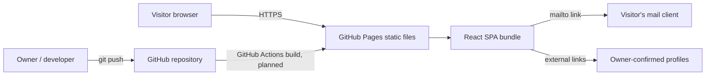
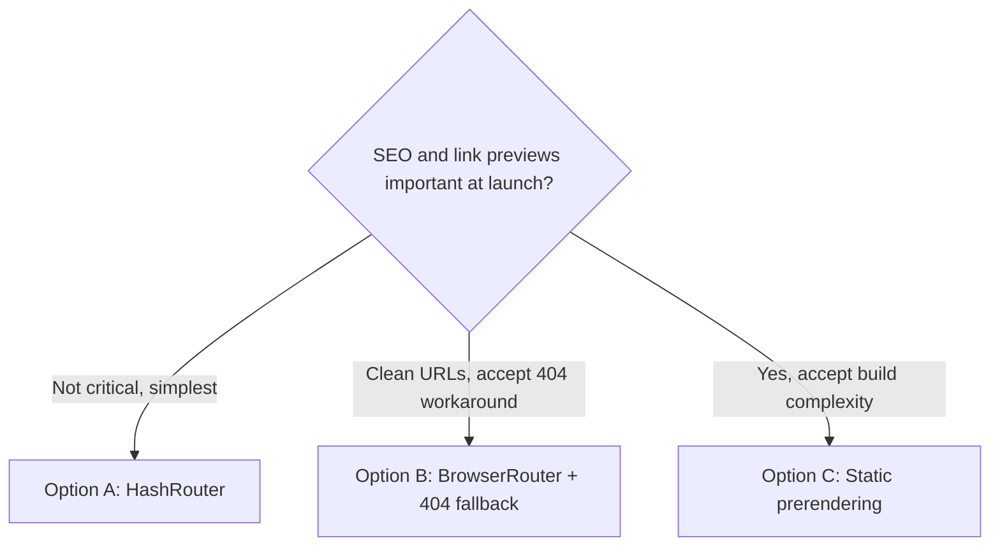
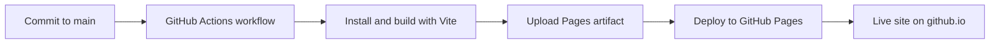

# ARCHITECTURE — Personal Portfolio Website

| Field | Value |
|---|---|
| Document status | Draft v0.1 — **planned architecture, nothing is implemented** |
| Last updated | 2026-11-06 |
| Related | [PRD.md](PRD.md), [TODO.md](TODO.md), [DEPLOYMENT.md](DEPLOYMENT.md), [DESIGN_GUIDELINES.md](DESIGN_GUIDELINES.md), [CONTENT_GUIDELINES.md](CONTENT_GUIDELINES.md) |

Status tags: **Accepted** (owner confirmed), **Proposed** (needs owner approval), **Open** (owner has deferred the decision; options documented). Proposed items are not binding.

---

## 1. Architecture overview

The website is planned as a **static, client-rendered single-page application** built with Vite and React (JavaScript), published as static files on GitHub Pages. There is no backend, database or server-side logic (NFR-005). The only interactive "service" is the visitor's own mail client, reached through a `mailto:` link (ADR-006).



## 2. Architecture decisions (index)

| ID | Decision | Status | Section |
|---|---|---|---|
| ADR-001 | Routing strategy | **Open** | 6, 21 |
| ADR-002 | Blog authoring approach | **Open** | 9, 21 |
| ADR-003 | Frontend stack: React + Vite + JavaScript | Accepted | 3, 21 |
| ADR-004 | Hosting: GitHub Pages on free domain | Accepted | 18, 21 |
| ADR-005 | Deployment through GitHub Actions | Proposed (OQ-016) | 19, 21 |
| ADR-006 | No backend or database; contact via `mailto:` | Accepted | 4, 21 |
| ADR-007 | ReactBits: free-only policy accepted; install method open | Accepted (policy) / Open (method) | 12, 21 |
| ADR-008 | Styling approach and ReactBits variant | **Open** (OQ-011) | 11, 21 |
| ADR-009 | Tooling and workflow conventions | **Open** (OQ-012) | 20, 21 |
| ADR-010 | No analytics or other third-party services in MVP | Proposed | 4, 21 |

## 3. Technology stack

| Layer | Technology | Status | Notes |
|---|---|---|---|
| UI library | React.js | Accepted | ADR-003 |
| Build tool | Vite | Accepted | ADR-003 |
| Language | JavaScript | Accepted | No TypeScript (owner choice). ReactBits provides JS variants |
| UI components | ReactBits (free) | Accepted | ADR-007 |
| Hosting | GitHub Pages | Accepted | ADR-004 |
| Version control / repo | Git / GitHub | Accepted | |
| Router library | To be determined | Open | Tied to ADR-001. A router is **not yet approved** as a dependency |
| Styling | To be determined | Open | ADR-008 |
| Markdown tooling | To be determined | Open | Only if ADR-002 chooses Markdown |
| Package manager, lint, format, test tools | To be determined | Open | ADR-009 |
| CI/CD | GitHub Actions | Proposed | ADR-005 |
| Backend / database | None | Accepted | ADR-006 |

Every new dependency must be recorded with purpose, cost, limitations and alternatives before adoption (NFR-014).

## 4. System boundaries

| Inside the system | Outside the system (not built) |
|---|---|
| Static pages, assets, client-side routing | Backend, database, authentication |
| `mailto:` link and visible email | Form handling or email delivery services |
| ReactBits-derived components copied into the repo | ReactBits Pro, ReactBits-hosted runtime services |
| Build and publish workflow (planned) | Analytics, tracking, CMS, comment systems (ADR-010, unapproved) |

External dependencies at runtime: GitHub Pages hosting; the visitor's mail client. Any web fonts or CDN assets would be external services and need approval (see section 11 and DESIGN_GUIDELINES.md).

## 5. Application structure

**Proposed (not approved)** layout, for discussion:

```text
/ (repository root)
├─ public/               static files copied as-is (résumé file, favicon, social image) — see section 10
├─ src/
│  ├─ app/               app shell, router setup
│  ├─ pages/             one module per page (PG-001 … PG-006)
│  ├─ sections/          page sections composed by pages
│  ├─ components/
│  │  ├─ ui/             small shared components
│  │  └─ reactbits/      vetted ReactBits-derived components, one folder each
│  ├─ content/           owner-supplied content (see section 9)
│  ├─ assets/            images processed by the build
│  └─ styles/            global styling and tokens (pending ADR-008 and design)
├─ docs/                 planning documents (or kept at repo root)
└─ .github/workflows/    deployment workflow (planned, Phase 8)
```

## 6. Routing strategy (ADR-001 — Open)

GitHub Pages serves static files only. A request for an address such as `/about` looks for a file at that path; a single-page app has none, so refresh and direct links need special handling.

| Option | URL style | How refresh works | Pros | Cons |
|---|---|---|---|---|
| A. HashRouter | `/#/about` | The fragment is never sent to the server, so the root file always loads | Simplest; no GitHub Pages workarounds | Less clean URLs; search engines generally treat fragment routes as one page; all routes share one set of `<head>` metadata and social previews |
| B. BrowserRouter + 404 fallback | `/about` | GitHub Pages returns its custom `404.html` for unknown paths; the fallback loads the app (for example by serving a copy of the app entry file or a redirect script) | Clean URLs | The server still answers with an HTTP 404 status before the app loads, which can hurt indexing; needs a workaround and correct base-path configuration |
| C. Static prerendering at build time | `/about` | Real HTML file generated per route | Best SEO and link previews on free static hosting; correct per-page metadata | Extra build-time tooling and complexity; ReactBits components using browser-only APIs may need guarding; tooling not yet evaluated |

Other routing facts to carry into the decision:

- Project sites are served from `https://<username>.github.io/<repository>/`; a repository named `<username>.github.io` is served from the root. This determines Vite's `base` setting and, for options B and C, the router's base path (OQ-006).
- Any decision here affects FR-009, FR-012, FR-013 and NFR-004.
- A router library is a new dependency that needs approval (NFR-014).

**Decision status:** Open. The owner chose to document all three and decide later. Tasks that depend on this decision are marked blocked in TODO.md.



## 7. Component architecture

**Proposed:** layers from general to specific.

| Layer | Responsibility | Example (illustrative) |
|---|---|---|
| App shell | Router, layout frame, global providers | Layout with navigation and footer |
| Pages | Compose sections for one route | A page module per PG-ID |
| Sections | Meaningful page blocks | Content blocks defined once design is approved |
| UI components | Reusable, presentation-only | Buttons, links, image components |
| ReactBits-derived components | Vetted third-party-origin components (section 12) | Added only after vetting and approval |
| Content | Plain data supplied by owner | See section 9 |

Principles: pages hold no hard-coded personal facts; components receive content through props; ReactBits-derived code stays in its own folder so its origin and modifications are traceable.

## 8. Page architecture

| Page | Route (strategy-dependent) | Primary content (CR IDs) | Blocking decisions |
|---|---|---|---|
| PG-001 Home | `/` | CR-001, CR-004, CR-005, CR-016 | OQ-004, OQ-007 |
| PG-002 About | `/about` (proposed) | CR-002, CR-012 | OQ-007 |
| PG-003 Experience / Education / Achievements | `/experience` (proposed) | CR-003, CR-007, CR-008, CR-009 | OQ-007 |
| PG-004 Contact | `/contact` (proposed) | CR-010, CR-011 | OQ-015 |
| PG-005 Blog / Writing | `/blog` (proposed), plus post routes if ADR-002 requires | CR-014 | OQ-003 |
| PG-006 Not found | any unknown route | none | ADR-001 |

Route names are proposals, not decisions. Section composition within each page is pending the visual identity (OQ-004). Projects is deliberately absent (OQ-001).

## 9. Data and content management approach

Goal: content separate from presentation (NFR-011).

| Option for static content (pages other than Blog) | Pros | Cons |
|---|---|---|
| JavaScript modules or JSON files in the repo | No extra dependencies; simple | Edits happen in code files |
| Markdown files processed at build time | Easy authoring for prose | Needs processing dependency |

For **blog posts** (ADR-002, Open) the options are:

| Option | Pros | Cons |
|---|---|---|
| Markdown files in the repo | Pleasant for long-form writing; content stays in the repo | Adds a processing dependency and build step |
| Posts as JavaScript / JSON data | No new dependencies; simplest | Awkward for long-form text |
| Links out to an external platform | No authoring system to build | Content lives off-site; adds an external service needing approval |

Placeholder convention: unresolved items are written as `[USER INPUT REQUIRED]` in content sources, so a text search can detect them (FR-014, AC-014). A planned check (TODO T2-07) will fail a build that contains the token.

## 10. Asset management

- **Static files that must keep a fixed address** (résumé file, favicon, social preview image): `public/` (proposed).
- **Images used by components:** `src/assets/` so the build can fingerprint and optimize them (proposed).
- **Base path safety:** all asset references must work under the configured base path (OQ-006). Vite exposes the base path to code, which avoids hard-coded absolute paths.
- **Optimization:** compress images and choose appropriate dimensions and formats; numeric budgets are pending OQ-008.
- **Alt text:** required for every meaningful image; decorative images are marked as such (NFR-002).
- **Rights:** only photos and visuals the owner has rights to use (OQ-013).
- **Size:** GitHub Pages published sites must be no larger than 1 GB (section 20), so large video or raw photos should be avoided.

## 11. Styling architecture (ADR-008 — Open)

ReactBits components come in four variants: JS + CSS, JS + Tailwind CSS, TS + CSS, TS + Tailwind CSS. Because the owner chose JavaScript, the relevant variants are **JS + CSS** and **JS + Tailwind**.

| Option | Pros | Cons |
|---|---|---|
| Plain CSS (JS + CSS variant) | No extra styling dependency; fewer moving parts | Theming and utilities written manually |
| Tailwind CSS (JS + Tailwind variant) | Fast utility styling; matches Tailwind variant of components | New dependency and build configuration; adds conceptual overhead |

No visual tokens (colors, type, spacing) are defined here. They belong to DESIGN_GUIDELINES.md after owner approval.

## 12. ReactBits integration strategy

Facts checked against reactbits.dev material on 2026-11-06:

- The free library is at reactbits.dev; components are installable with CLI tools (shadcn or jsrepo) or by copying code from the component's page.
- **React Bits Pro is a separate, paid product** (pro.reactbits.dev) distributed through a license-key registry. It is **excluded** (NFR-006, OOS-005).
- A mirror of the free repository lists the MIT license. The license of the official repository must be re-confirmed when the first component is vetted.
- Individual components may depend on third-party libraries (the vendor's Pro page lists animation and 3D libraries such as motion, GSAP and three.js as examples of what its own components use). Each free component's real dependencies must be read from its page when selected, not assumed.

**Vetting checklist (one record per component, stored per DESIGN_GUIDELINES.md section 12 (template in section 10)):**

1. Source page URL and variant (JS + CSS or JS + Tailwind).
2. Confirmed free: not from the Pro registry and no license key required.
3. License terms re-checked.
4. Dependencies listed with purpose, size and alternatives (NFR-014).
5. Compatible with React and Vite as used in this project.
6. Works under the chosen routing option (for example browser-only or WebGL code under prerendering).
7. Accessibility: keyboard use, contrast, reduced-motion behavior (NFR-002, NFR-012).
8. Responsiveness and performance impact (NFR-001, NFR-003).
9. Consistent with other approved components; no conflicting UX.
10. Owner approval recorded.

**Rules:** preserve the component's intended behavior where practical; do not replace ReactBits with another library without approval; propose alternatives with trade-offs and wait for the owner's decision. Install method (CLI versus copying code) is **Open** under ADR-007.

## 13. Responsive design considerations

Requirement: NFR-001. Breakpoints, layout approach and touch behavior are pending the approved design. Responsive behavior must be checked per component during vetting and again in Phase 6.

## 14. Accessibility strategy

Requirement: NFR-002, NFR-012. Plan: semantic HTML landmarks, keyboard-operable navigation, visible focus, text alternatives, adequate contrast, and reduced-motion support. Conformance target open (OQ-009; WCAG 2.2 AA proposed). Verification in Phase 6 with automated and manual checks. Automated tools do not prove full conformance.

## 15. SEO strategy

Requirement: NFR-004, FR-012.

- Client-rendered React sends a near-empty HTML shell; search engines that run JavaScript can index it, but other crawlers and social link previews usually read only the initial HTML.
- Option A (hash routing) gives all routes one URL and one metadata set. Options B and C allow distinct URLs; only C produces distinct pre-built HTML and metadata per page.
- Baseline regardless of option: descriptive titles and descriptions, semantic headings, Open Graph and social tags in the base HTML, sitemap and robots files if the routing option makes them meaningful.
- Realistic expectation: stronger SEO requires option C. This is a trade-off the owner decides in ADR-001.

## 16. Performance strategy

Requirement: NFR-003, NFR-013. Plan: optimized images, lazy loading where appropriate, code-splitting by route if routing allows, caution with heavy animation or 3D dependencies, dependency review in Phase 7, and Lighthouse baselines recorded (SM-003). Numeric targets pending OQ-008.

## 17. Security considerations

- No server code and no secrets are required for the MVP. Any build-time variable exposed to client code is public.
- The repository must be public on GitHub Free for Pages (CON-008), so no private data may be committed.
- External links should use safe link attributes.
- The visible email address can be scraped; obfuscation is an open decision (OQ-015, RSK-007).
- Dependency hygiene: minimal dependencies, documented, reviewed for known vulnerabilities before release.

## 18. GitHub Pages deployment architecture

See [DEPLOYMENT.md](DEPLOYMENT.md). Summary: the built static files are published to GitHub Pages under the free github.io domain (ADR-004). Address form depends on the repository name (OQ-006).



## 19. GitHub Actions strategy (ADR-005 — Proposed)

GitHub's documentation recommends a GitHub Actions workflow when a site uses a build process other than Jekyll. Custom Actions workflows are also exempt from the soft limit of 10 builds per hour that applies to branch-based publishing. Planned design (details in DEPLOYMENT.md): trigger on pushes to the default branch; steps to check out, set up Node, install, build, configure Pages, upload artifact and deploy; least-privilege permissions; no secrets required. Awaiting approval (OQ-016).

## 20. Technical constraints

| ID | Constraint | Source / note |
|---|---|---|
| TC-001 | Static files only; no server-side languages | GitHub Pages documentation |
| TC-002 | Published site no larger than 1 GB; source repository recommended no larger than 1 GB | GitHub Pages limits |
| TC-003 | Soft bandwidth limit of 100 GB per month | GitHub Pages limits |
| TC-004 | Soft limit of 10 builds per hour for branch publishing; not applicable to custom Actions workflows | GitHub Pages limits |
| TC-005 | Deployment times out after 10 minutes | GitHub Pages limits |
| TC-006 | GitHub Free requires a public repository for Pages | GitHub Pages availability |
| TC-007 | Pages must not be used as free hosting for an online business or primarily commercial transaction site | GitHub Pages limits; portfolio only |
| TC-008 | No control over server headers or redirects | Inherent to static hosting |
| TC-009 | Free ReactBits components only | NFR-006 |
| TC-010 | Limits above should be re-checked at deployment time, since GitHub may change them | Process note |

Tooling (ADR-009, Open): package manager, linting and formatting, unit and end-to-end testing choices, and Git workflow conventions are undecided. The planned verification activities are fixed in TODO.md Phase 7, but tool names are not.

## 21. Architecture Decision Records

### ADR-001 — Routing strategy
- **Status:** Open (OQ-002)
- **Context:** GitHub Pages is static; refresh and deep links need handling (RSK-001).
- **Options:** A HashRouter; B BrowserRouter + 404 fallback; C static prerendering (section 6).
- **Rationale for deferral:** owner asked to document all three and decide later.
- **Consequences:** blocks routing tasks (T2-02, T2-05, T2-06), base-path setup (T1-03) and deployment verification details.

### ADR-002 — Blog authoring approach
- **Status:** Open (OQ-003)
- **Options:** Markdown in repo; JS/JSON data; external platform (section 9).
- **Consequences:** affects FR-006, FR-007, NFR-011 and dependencies.

### ADR-003 — Frontend stack
- **Status:** Accepted
- **Decision:** React.js, Vite, JavaScript.
- **Alternatives considered:** none; confirmed by owner.

### ADR-004 — Hosting
- **Status:** Accepted
- **Decision:** GitHub Pages on the free GitHub Pages domain; no custom domain.
- **Alternatives:** other static hosts — not pursued.

### ADR-005 — Deployment method
- **Status:** Proposed (OQ-016)
- **Decision (proposed):** GitHub Actions workflow.
- **Alternative:** publish from a branch (Pages default flow, limited to 10 builds per hour and not designed for Vite builds).
- **Rationale:** GitHub's own guidance for non-Jekyll build processes.

### ADR-006 — No backend; contact via `mailto:`
- **Status:** Accepted
- **Decision:** visible email and `mailto:` link; no form service.
- **Trade-offs accepted:** depends on visitor's mail client; spam exposure.
- **Alternatives:** third-party form service (OPT-001); links only.

### ADR-007 — ReactBits integration
- **Status:** Accepted (free-only policy); install method Open
- **Decision:** free components only, vetted per section 12; Pro excluded.
- **Open:** CLI install versus copy-paste.

### ADR-008 — Styling approach
- **Status:** Open (OQ-011)
- **Options:** plain CSS; Tailwind (section 11).

### ADR-009 — Tooling and workflow conventions
- **Status:** Open (OQ-012)
- **Scope:** package manager, linting/formatting, test tooling, Git workflow, commit conventions.

### ADR-010 — No analytics or other third-party services in MVP
- **Status:** Proposed (OQ-008)
- **Rationale:** the owner must approve every external service; none has been requested.
