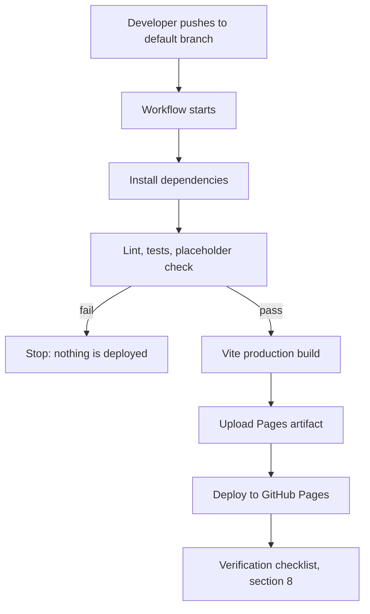

# DEPLOYMENT — Personal Portfolio Website

| Field | Value |
|---|---|
| Document status | Draft v0.1 — **describes the PLANNED process only. Nothing has been configured or executed** |
| Last updated | 2026-11-06 |
| Related | [ARCHITECTURE.md](ARCHITECTURE.md) §18–§20, [TODO.md](TODO.md) Phase 8, [PRD.md](PRD.md) |

Items marked `OPEN` depend on undecided questions: repository name and account plan (OQ-006), routing strategy (OQ-002 / ADR-001), and approval of GitHub Actions (OQ-016 / ADR-005).

---

## 1. GitHub repository requirements

| Requirement | Detail |
|---|---|
| Account and repository | GitHub account and repository created by or for the owner — username and name `[USER INPUT REQUIRED]` (OQ-006) |
| Visibility | **Public**, because GitHub Pages on GitHub Free is available for public repositories only; private-repository publishing needs a paid plan. The owner's plan is unknown (OQ-006) |
| Default branch | Name `OPEN`; workflow triggers must match it |
| Repository name | Determines the site address and Vite base path (section 3) |
| Contents | No secrets, no private data (the repository is public) |
| Size | Recommended source repository size is at most 1 GB; large binaries committed once remain in Git history |

## 2. GitHub Pages configuration

Planned settings (to be applied in Phase 8, task T8-01):

| Setting | Planned value |
|---|---|
| Publishing source | **GitHub Actions** (not "deploy from a branch") — pending ADR-005 approval |
| Domain | Default `github.io` address (free). No custom domain (OOS-006) |
| HTTPS enforcement | Enabled where GitHub offers it |
| Environment | `github-pages` (created by GitHub when Pages is enabled) |

Resulting address (depends on repository name):

| Repository name | Site address | Vite `base` |
|---|---|---|
| `<username>.github.io` | `https://<username>.github.io/` | `/` |
| any other name `<repo>` | `https://<username>.github.io/<repo>/` | `/<repo>/` |

## 3. Vite deployment configuration

- Set the Vite `base` option to match the table above (task T1-03).
- Reference static assets so they resolve under the base path; Vite exposes the base value to application code, so hard-coded absolute paths such as `/resume.pdf` must be avoided (ARCHITECTURE.md §10).
- Build output is the `dist` folder (Vite default). Confirm when the project is initialized.
- Any environment variable prefixed for client exposure by Vite is **public** in the built bundle. The MVP needs no environment variables or secrets.
- If routing option B or C is chosen (ADR-001), the router's base path must match Vite's `base`.

## 4. GitHub Actions workflow design (planned, ADR-005 Proposed)

Not yet created. Design:

| Aspect | Plan |
|---|---|
| Triggers | Push to the default branch; manual run (workflow dispatch) |
| Permissions | Least privilege: read repository contents; write Pages; write identity token (required by the Pages deploy action) |
| Concurrency | One deployment at a time; do not cancel an in-progress deployment |
| Job 1 — build | Check out code; set up Node.js (version per T0-11) with dependency caching; install from the lockfile; run lint and tests (ADR-009); run the placeholder check (T2-07); build with Vite; configure Pages; upload the `dist` folder as the Pages artifact |
| Job 2 — deploy | Depends on build; runs in the `github-pages` environment; deploys the artifact |
| Official actions | Use GitHub's official Pages actions (configure-pages, upload-pages-artifact, deploy-pages) plus checkout and setup-node. Pin and verify current versions when writing the workflow (do not rely on this document for version numbers) |
| Secrets | None required |
| Limits | Deployment times out after 10 minutes; custom workflows are exempt from the 10-builds-per-hour soft limit that applies to branch publishing |

## 5. Build and deployment process

Local pre-release routine (planned): run the production build, preview it under the same base path as production, and check refresh and direct links before pushing.

## 6. Routing considerations (ADR-001, OPEN)

| Option | Deployment impact |
|---|---|
| A. HashRouter | No extra deployment work; refresh works; all routes share one address and one metadata set |
| B. BrowserRouter + 404 fallback | The build must also produce a `404.html` that loads the app, and the router base path must match Vite's `base`. Unknown and deep paths respond with HTTP 404 before the app takes over |
| C. Static prerendering | The build must emit an HTML file per route; verify each generated file after deploy; browser-only component code must be guarded during prerendering |

Whichever is chosen, update this section, ARCHITECTURE.md §6 and TODO tasks T2-02, T2-05, T2-06 and T7-07 together.

## 7. Domain configuration

- Planned: the free GitHub Pages domain only (confirmed). No DNS records, no custom domain.
- Because the site lives under `github.io`, it does not need its own domain registration.
- A custom domain is out of scope (OOS-006); adding one later would need a new decision and PRD update.

## 8. Deployment verification

Run after each deployment. Mark each item only after it has actually been checked on the live address.

| # | Check | Reference |
|---|---|---|
| 1 | Workflow run finished successfully | Actions tab |
| 2 | Home loads at the expected address with no console errors for missing files | SM-001 |
| 3 | Every MVP page is reachable from navigation | AC-008 |
| 4 | Each MVP page opens from a direct URL and survives refresh | AC-009 |
| 5 | An unknown address shows the intended behavior | AC-013 |
| 6 | Images, fonts and the résumé file load (no wrong base path) | AC-005, AC-011 |
| 7 | The `mailto:` link opens a mail client addressed to the owner | AC-004 |
| 8 | Page titles and descriptions are distinct | AC-012 |
| 9 | No placeholder token appears anywhere on the site | AC-014 |
| 10 | Lighthouse baseline recorded | SM-003 |
| 11 | Published size and structure are within limits | TC-002 |

## 9. Troubleshooting

| Symptom | Likely cause | Check |
|---|---|---|
| Blank page, missing styles or scripts | Wrong Vite `base` for the repository name | Compare `base` with the address table in section 2 |
| Images or résumé return "not found" | Hard-coded absolute paths ignoring the base path | Use base-aware references (section 3) |
| Page works from the home link but 404s on refresh | Routing option B without a working `404.html`, or option A/B base mismatch | Section 6 |
| Workflow fails at the deploy step with a permissions error | Pages source not set to GitHub Actions, or missing workflow permissions | Sections 2 and 4 |
| Pages option unavailable | Repository is private on a plan that does not support Pages | Section 1 |
| Old content after a deploy | Browser or CDN caching | Hard refresh; wait briefly; confirm the run succeeded |
| Deployment times out | Very large artifact or slow step | Inspect artifact size; limit is 10 minutes |
| Site rejected or throttled | Soft limits exceeded (1 GB site, 100 GB/month bandwidth) | ARCHITECTURE.md §20 |
| `mailto:` does nothing | Visitor has no mail client configured | Expected trade-off of ADR-006; consider showing the address as text too (already planned) |

## 10. Rollback considerations

| Situation | Planned response |
|---|---|
| A bad change was deployed | Revert the offending commit on the default branch; the workflow redeploys the previous state |
| Deployment broke the site and a known-good commit exists | Check out that commit via a revert or a fix-forward commit, then deploy |
| Workflow itself is broken | Disable the workflow, fix on a branch, re-enable |
| Re-running an old workflow run | Behavior (rebuild from that commit versus reuse of an expired artifact) must be verified during the rehearsal in task T8-05; do not rely on it |

Planned practice (needs owner approval under ADR-009): tag releases so known-good states are easy to find. Unpublishing the site entirely is possible from the repository's Pages settings.

## 11. Open items

| ID | Item |
|---|---|
| OQ-002 | Routing strategy — affects sections 3, 5, 6, 8 |
| OQ-006 | Username, repository name and account plan — affects sections 1–3 |
| OQ-016 | Approval of GitHub Actions deployment — affects sections 2, 4 |
| OQ-012 | Node version, package manager, test tooling — affects section 4 |
